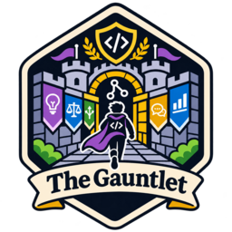

<p align="center">
  
</p>

# The Gauntlet

Joe's personal, on-demand Rails code reviewer for Claude Code. The name is a joke about the team
running the gauntlet when Joe reviews. The review is meant to be supportive and educational: it makes
the author think about how they built something, whether there is another way, and what each way costs.

This is Joe's tool, written in Joe's voice. Built and tested on Claude Code only.

## What a review looks like

- **Design findings** (at most 6, ranked): what was noticed as a question, *another way to do it*, the
  trade-off, and the weight in plain words ("curiosity only", "I'd want this settled before merge").
- **Details** (about 8 at most, inline, each marked non-blocking): names, context, small mistakes and
  tests. Repeats are grouped into one comment.
- Correctness and data integrity come first (partial failure, transactions, idempotency), then design,
  then details. Anything RuboCop enforces is dropped.
- It infers whether the change is a hack or built to stand, says so in the summary, and Joe can
  override. Draft PRs get direction, risk and design feedback only.
- A small diff gets a small review.

## Use

Ask Claude Code to review a PR or branch: "gauntlet this PR", "review #123 with the gauntlet".

- **Teammate mode:** a PR by someone else. Comments are addressed to the author.
- **Self mode:** your own branch or PR. Claude talks to you directly, and anything posted is written
  for later readers.

Nothing is posted unless you ask. Posting is a draft, then a dry run, then your approval of the exact
text, then one GitHub review with inline comments. The event is always `COMMENT`: it never approves or
requests changes. The review is pinned to the commit it read, and the script refuses to post if the PR
head has moved. A human merges.

## Install

Symlink the folder into your skills directory:

```sh
ln -s "$(pwd)/skills/gauntlet" ~/.claude/skills/gauntlet
```

It needs `python3` (standard library only) and an authenticated `gh`.

## What is in the folder

| File | What it is |
| --- | --- |
| `SKILL.md` | The review flow Claude follows |
| `lenses.md` | SOLID, POODR, Tell Don't Ask, Clean Code, Fowler's PoEAA, Gang of Four, DDD: ways of reasoning, never rules |
| `lenses-frontend.md` | The same kind of lenses for React and browser JavaScript or TypeScript: correctness in the browser, state and effects, components, types, accessibility, performance and testing |
| `digest.md` | Hot points from `standards/`, each citing its section |
| `voice-examples.md` | Joe's real review comments, condensed, names removed |
| `scripts/check_digest.py` | Checks the digest for drift and for citations to sections that no longer exist |
| `scripts/fetch_voice.py` | Fetches an author's inline review comments from a repo, to refresh the voice examples |
| `scripts/post_review.py` | Builds and posts the comment-only review |
| `assets/badge.png` | The badge shown at the top of a posted summary |
| `evals/` | Fixture diffs and the criteria a good review meets |
| `tests/` | Unit tests |

## Maintenance

- **Standards changed?** Run `python3 skills/gauntlet/scripts/check_digest.py`. `STALE:` means
  `standards/` changed since the digest was written, and `BROKEN:` means a cited section is gone.
  Update the digest, then its `synced-standards-tree` line.
- **More voice?** `python3 skills/gauntlet/scripts/fetch_voice.py <owner/repo> <github-login>`, read
  the output, and add condensed examples with names removed.
- **Too noisy or too quiet?** Adjust the caps and rules in `SKILL.md` section 6, then re-run the
  fixtures in `evals/`.

## Tests

```sh
python3 -m unittest discover -s skills/gauntlet/tests
```

## Later

The seams are in place to share it with the team: voice examples are their own file, the reviewer's
name comes from `gh`, and the install is a symlink. A shared voice or per-person voices would be a
later decision, not part of v1.
